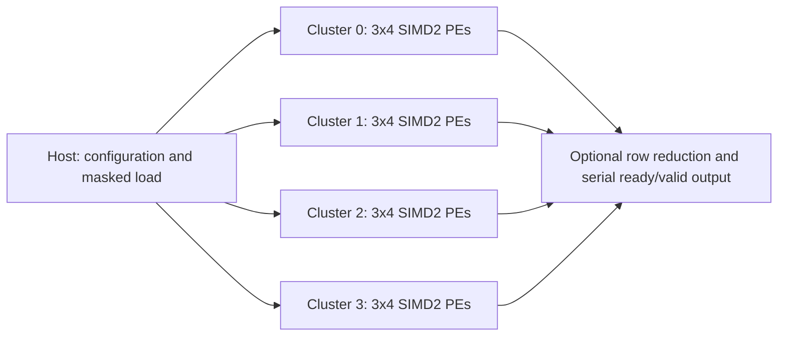

# MA: four-cluster RTL baseline

基于 Eyeriss v2 论文结构的原创 RTL 第一版，用于功能验证、数据流实验和后续综合比较。
**这是 dense baseline，不是原论文芯片的完整复刻。** 详细规格、论文位置和简化项见
[规格说明](docs/spec-v1.md)。

## 实现范围

- 4 个独立 cluster，每个 3x4 个 PE：共 48 PE、96 条 8-bit SIMD MAC 通路。
- signed/unsigned 8-bit 激活，signed 8-bit 权重，20-bit 回绕累加。
- 每 PE：16x8 激活、96x16 双权重、32x20 部分和 scratchpad。
- 按 cluster/PE mask 单播或多播加载；1/2/4 cluster 可选择运行。
- 可选三行归约，支持把 3xS 卷积映射到三行 PE、四个输出位置和两条输出通道。
- ready/valid 输出、背压、配置快照、复位中止、非法请求检查和计算计数器。

暂不包含 CSC 稀疏解码、完整 HM-NoC 路由、12 KB/cluster GLB、DMA、量化/ReLU、
SRAM 宏和自动 CNN 层映射器。当前多播是集中式 fanout，行归约是输出加法树。
因此不能把这里的结果当作原论文的稀疏加速比、能效或物理 PPA。



## 在 VS Code 里测试

VS Code 是编辑器；pyuvm/cocotb 需要 RTL 仿真器。建议 Windows 上使用 VS Code
Remote - SSH 连接 `prakt19.eda.cit.tum.de`，在远程 Linux 里打开项目并运行测试。
也可以在本地 WSL Linux 中安装相同依赖。当前 Windows 环境没有可用的 Linux
发行版或已检测到的 Icarus/Verilator，不能把 Python 单元测试误当 RTL 仿真。

```bash
git clone https://github.com/minjunzhong/MA.git
cd MA
python3 -m venv .venv
source .venv/bin/activate
python -m pip install -r requirements.txt
# If needed on a personally administered Linux machine:
# sudo apt-get install iverilog verilator make
make test
make lint
```

首次连接远程服务器需要正常的 TUM 登录权限；不要将账号密码、SSH 私钥或学校工艺库
放入 GitHub。仓库无需保存任何登录凭据。已有密钥在该服务器尚未配置时可用：

```powershell
ssh -o PubkeyAuthentication=no ge47cup@prakt19.eda.cit.tum.de
```

在 VS Code Remote - SSH 或 WSL 中打开仓库后，可通过“运行测试任务”执行
`RTL: pyuvm acceptance`；任务假设 `.venv` 已创建。普通 Windows 本地窗口不能直接
执行这些 Linux 任务。

## 验证结构与 TDD

`tests/reference.py` 是 Python 整数参考模型，包括独立的卷积计算；`test_four_cluster.py`
包含 pyuvm driver、独立输出 monitor、analysis port/export 和 scoreboard。
验收测试覆盖有符号边界、unsigned 激活、多播隔离、20-bit 溢出和累加槽、
3x3 卷积、随机配置/背压、配置隔离、非法请求、复位中止和规模计数。

测试与规格先于真实 RTL 提交。`tests/red_stub.sv` 只用于重现红灯阶段，不属于综合文件集：

```bash
make TDD_RED=1 SIM_BUILD=sim_build/red COCOTB_RESULTS_FILE=red-results.xml
python3 scripts/check_results.py red-results.xml --expect-failure
make test
```

红灯预期 9 项全部失败，真实实现预期 9 项全部通过。`make test` 会解析 JUnit XML，
避免某些 cocotb/Make 组合在测试失败时仍返回 0 的问题。
已测证据见 [验证记录](docs/validation.md)（包括实际运行环境和限制）。
GitHub Actions 会重新执行功能测试与 lint；不在 CI 内运行需要学校许可证的 Genus。

## 性能：先区分周期和物理时序

`reports/local/benchmark.json` 由实际 RTL 仿真产生：

- `compute_cycles` / `macs`：核心计算周期和 MAC 次数（一次乘加算一个 MAC）。
- `start_to_done_cycles`：开始被接受到最后输出被接受之间的时钟间隔。
- `host_load_cycles`：当前逐地址加载驱动所用周期，包括 valid 撤销周期。
- `end_to_end_cycles`：加载周期 + 启动周期 + start-to-done 间隔。
- `end_to_end_macs_per_cycle`：包括加载和串行输出的有效吞吐率。

四 cluster 的核心理论峰值是 96 MAC/cycle；串行加载和输出会显著限制端到端吞吐率。
测试的 10 ns 时钟是仿真激励，不是综合得到的 Fmax。当前 benchmark 评估的是相同 K
下更多并行工作，不是同一固定工作量的 strong-scaling 加速比。

## Genus

从服务器上的仓库根目录运行，先检查读入：

```bash
export LANG=C LC_ALL=C
GENUS=/nas/ei/share/tools/cadence/GENUS/GENUS_21.17.000-ISR7/bin/genus
GENUS_BIN="$GENUS" python3 scripts/run_genus.py --stage parse
```

真正的工艺映射需要老师提供有读取权限的 Liberty 文件及适用 corner：

```bash
export LIBERTY_FILE=/absolute/path/to/authorized_corner.lib
# Unit is the Liberty time unit; 10 is 10 ns only for a 1 ns library.
export CLOCK_PERIOD=10
GENUS_BIN="$GENUS" python3 scripts/run_genus.py --stage synthesize
```

该服务器上的 Genus 在展开阶段也要求目标库；设置 `LIBERTY_FILE` 后，可用
`python3 scripts/run_genus.py --stage elaborate` 只做展开检查。运行包装器会检查完成标记，
避免工具遇到 Tcl 错误却返回退出码 0 时误报成功。仓库还提供一个从 OpenROAD 官方仓库下载开源
Nangate45 库的脚本用于流程示范。该库是用于研究/测试的不可制造示范库，不是学校
的目标 PDK，也不是论文的 TSMC 65 nm；这些结果只能在相同示范条件下比较：

```bash
python3 scripts/fetch_demo_library.py
export LIBERTY_FILE="$PWD/build/demo-lib/NangateOpenCellLibrary_typical.lib"
export CLOCK_PERIOD=10
GENUS_BIN="$GENUS" python3 scripts/run_genus.py --stage synthesize
```

输出位于 `build/genus/`：timing、area、QoR、vectorless power、网表、SDC 和假设记录。
报告功耗没有实际 workload switching activity，只能作为 vectorless 估计。
`.lib`/`.db`/`.lef`/`.gds` 等工艺文件被忽略，不应上传。
当前 scratchpad 是 RTL 推断存储，不做 SRAM 宏映射，面积不能直接对照论文。
应使用相同库/corner、频率目标和约束比较后续版本；布局布线后的时序与功耗仍需另行评估。

## 文件

| 路径 | 内容 |
|---|---|
| `docs/spec-v1.md` | 论文依据、规格、端口和验收条件 |
| `rtl/` | PE、cluster 和四 cluster 顶层 |
| `tests/` | 参考模型、pyuvm 验证环境、红灯占位模块 |
| `synth/` | Genus 展开、综合和约束脚本 |
| `scripts/check_results.py` | 强制检查测试结果 |
| `.github/workflows/rtl.yml` | 仿真与 lint CI |
| `.vscode/tasks.json` | Linux/Remote SSH/WSL 测试任务 |

Reference papers and proprietary CAD/PDK files are not distributed here.

## 第一版已测结果

- pyuvm：9/9 验收测试通过，红灯占位版本 0/9；远程重克隆后再次验证通过。
- Verilator lint 与 GitHub Actions：通过。
- Genus 示范综合：Nangate45 typical、10 ns 目标下 WNS +5.6981 ns，TNS 0。
- Vectorless 功耗估计约 97.8 mW；存储使用寄存器推断，没有 SRAM 宏和布局布线。

完整数值、原始报告和限制见 [验证记录](docs/validation.md)。这组示范 PPA 不是课程目标
工艺或论文 65 nm 的结果，也不是 Fmax 或真实 workload 功耗。
